<div align="center">

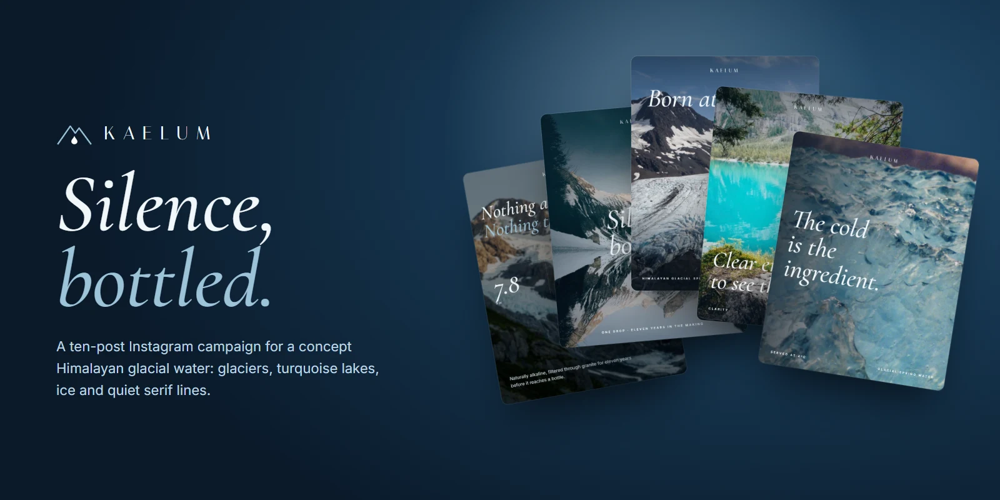

<br>

# Kaelum Springs

**A 10-post Instagram campaign for a concept premium glacial water.**
Glaciers, turquoise lakes and ice, with quiet serif lines that make still water feel like luxury.


[**See it live on my portfolio →**](https://guru1315-portfolio.vercel.app/graphic-designer)

</div>

---

## The brief

Kaelum is a fictional mineral water bottled at a Himalayan spring, 4,200 metres up. Bottled-water ads usually look the same: blue gradients, splashes and promises of "freshness". Kaelum's campaign does the opposite and **sells silence**: cold air, still lakes, eleven years of filtering through granite. The posts are calm, airy and confident, closer to a luxury fragrance than a drinks brand.

> *"Silence, bottled."*

## The campaign

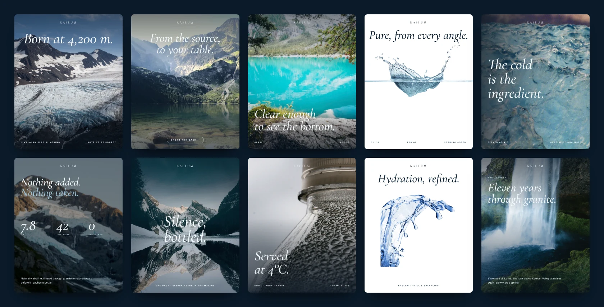

| # | Post | The job it does |
|:-:|---|---|
| 01 | **Born at 4,200 m.** | The hero. Where the water comes from, said in one line. |
| 02 | **From the source, to your table.** | The journey, ending in an *Order the case* call to action. |
| 03 | **Clear enough to see the bottom.** | Purity shown through clarity instead of claimed. |
| 04 | **Pure, from every angle.** | A clean white product-style post: pH, TDS, nothing added. |
| 05 | **The cold is the ingredient.** | Ice texture with the brand's boldest line. |
| 06 | **Nothing added. Nothing taken.** | The facts post: pH 7.8, TDS 42 mg/l, 0 additives. |
| 07 | **Silence, bottled.** | The brand idea over a mirror-still lake. |
| 08 | **Served at 4°C.** | A macro of condensation on the bottle: the serving ritual. |
| 09 | **Hydration, refined.** | A sculptural splash on white, for the still & sparkling range. |
| 10 | **Eleven years through granite.** | The origin story, told over a waterfall. |

<details>
<summary><b>View every post full size</b></summary>
<br>

<p align="center">
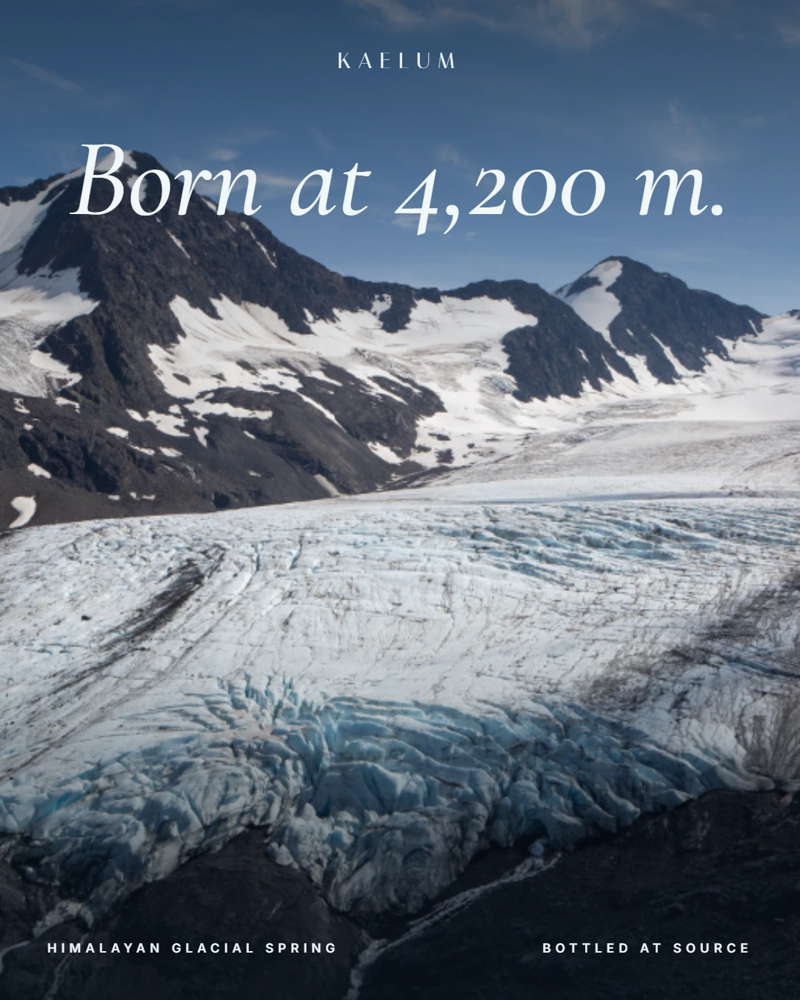
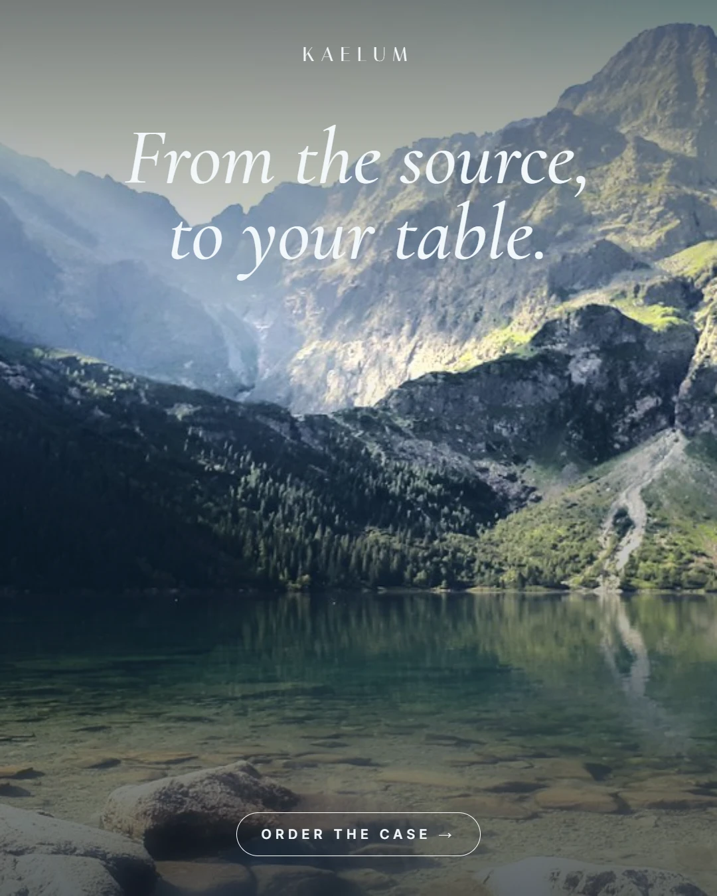
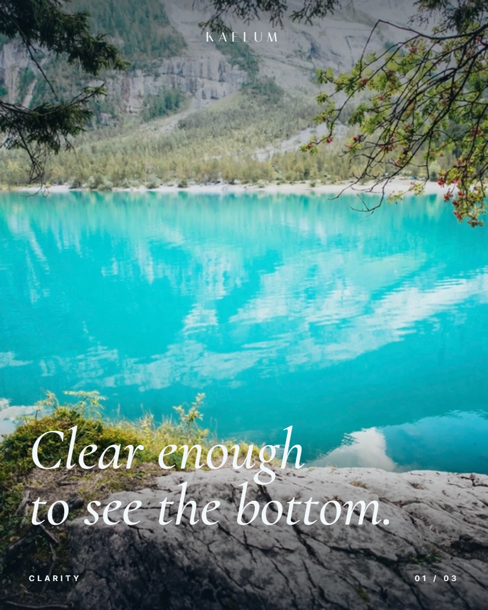
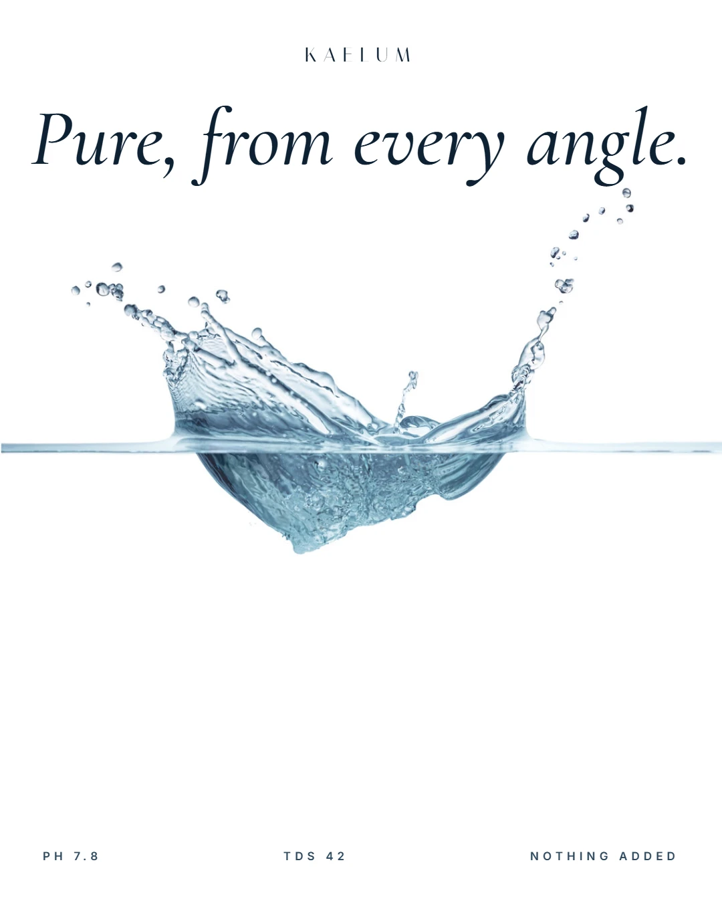
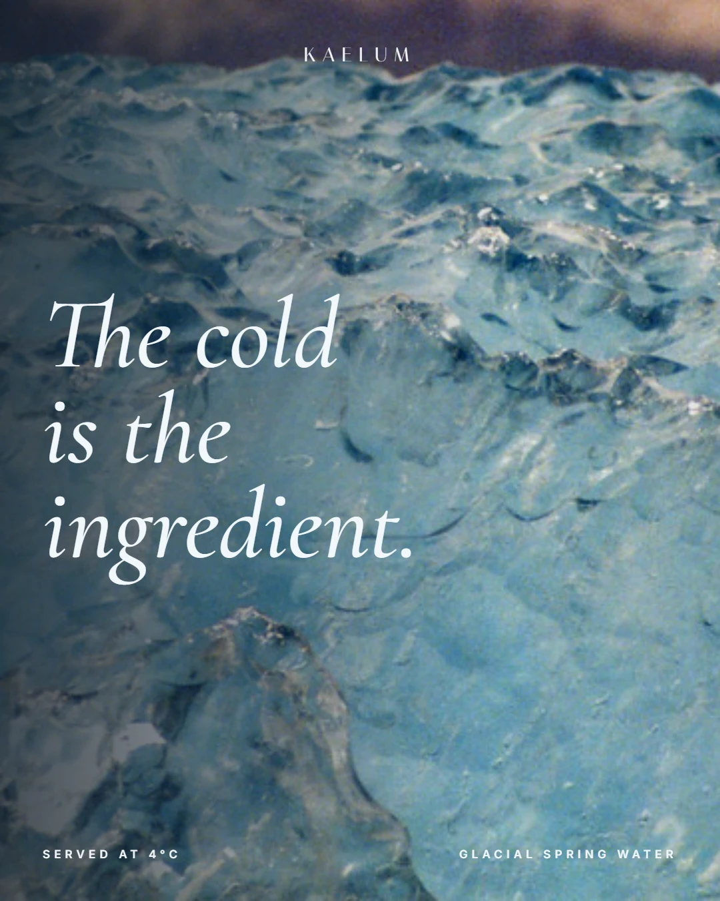
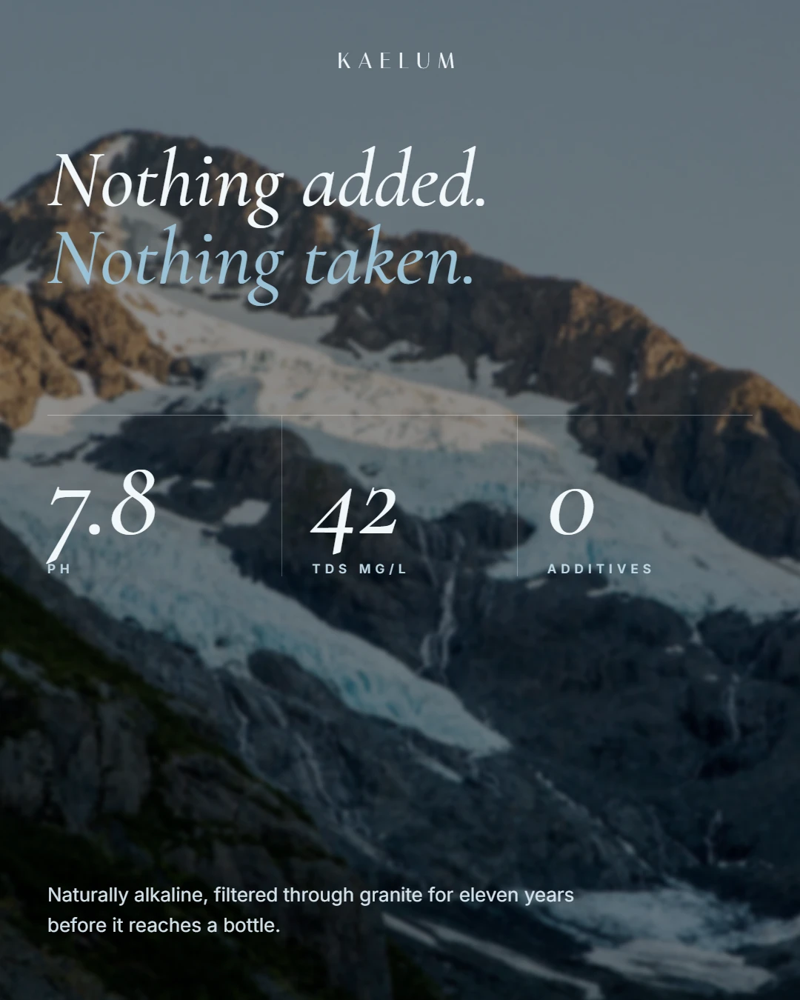
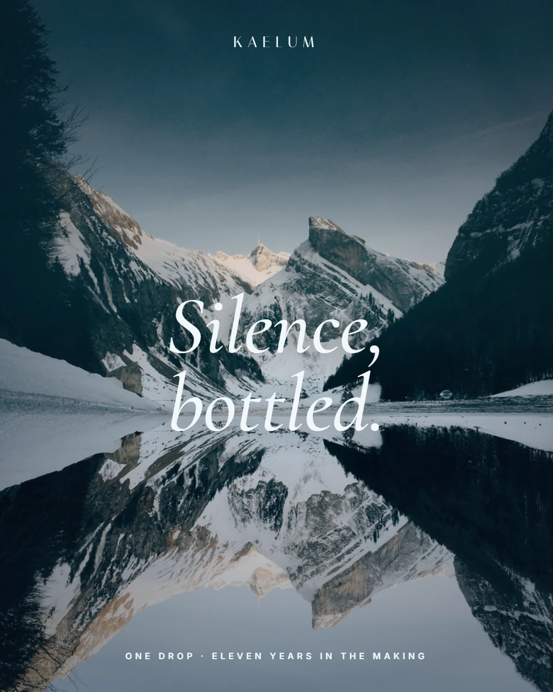
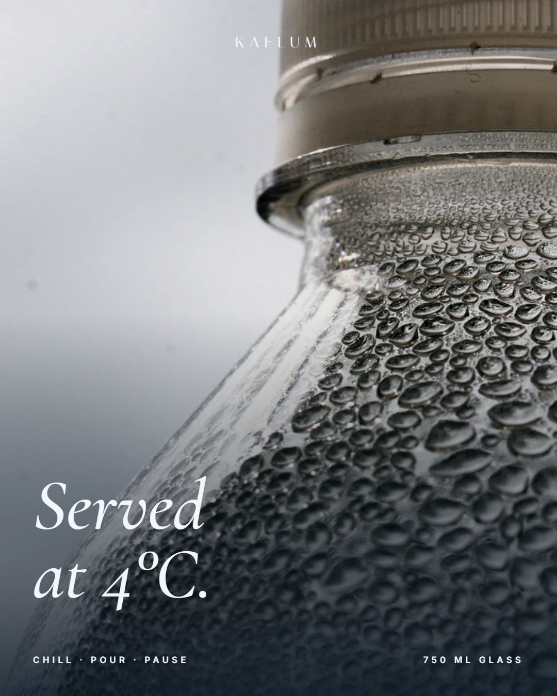
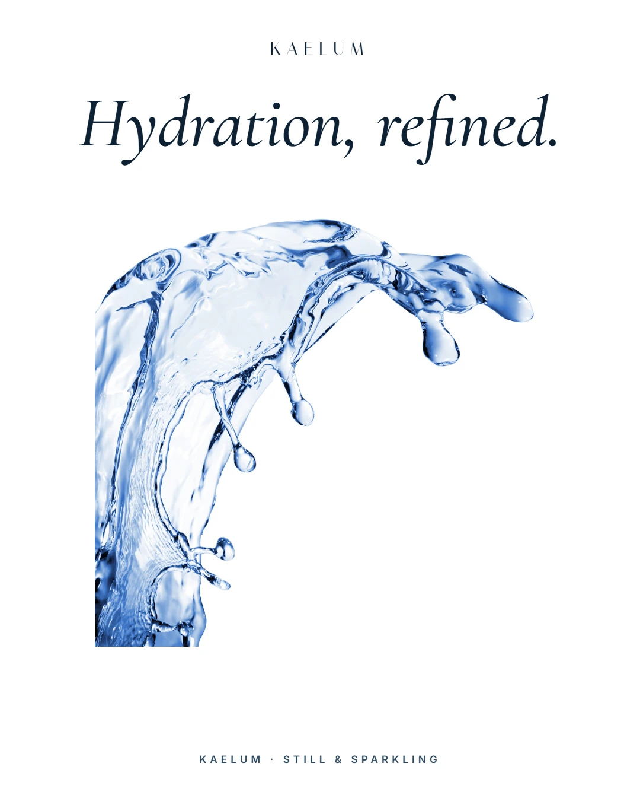
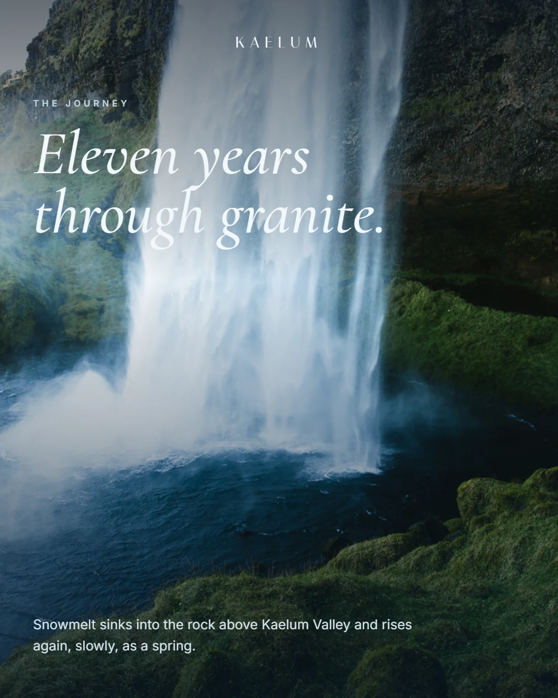
</p>

</details>

## Brand identity

<p align="center">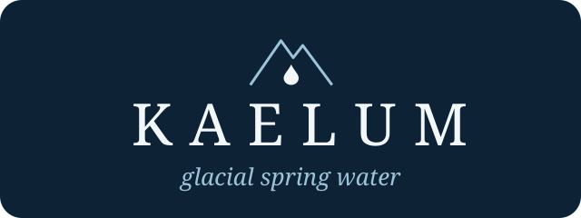</p>

**The mark** is a mountain ridge with a single drop of water falling from it: the source and the product in one line. The widely spaced KAELUM wordmark gives it the stillness of a luxury label ([logo on photo](brand/logo-on-photo.webp)).

### Colour

| | Name | Hex | Used for |
|:-:|---|---|---|
|  | Snowmelt | `#F2F7FA` | Type on photos |
|  | Glacier blue | `#9CC3D8` | Accents, second lines |
|  | Slate | `#2E4A61` | Labels on white |
|  | Deep lake | `#0D2235` | Type on white, dark layouts |
|  | Pure white | `#FFFFFF` | Product-style posts |

### Type

- **[Italiana](https://fonts.google.com/specimen/Italiana)**: the KAELUM wordmark, spaced wide like an engraved label.
- **[Cormorant Garamond](https://fonts.google.com/specimen/Cormorant+Garamond)** (*Italic 500*): every headline. Soft, calm, almost handwritten.
- **[Inter](https://fonts.google.com/specimen/Inter)** (600, spaced caps): small labels, facts and footers.

### The rules the campaign follows

1. **Say less.** Every headline is two to six words. The landscape does the talking.
2. **Cold colours only.** Every photo is graded towards blue and white, and there are no warm tones anywhere.
3. **Facts stay small.** pH, TDS and temperature appear in small spaced caps, never as the headline.
4. **The same frame every time.** KAELUM sits top-centre and the labels sit along the bottom edge, so the grid reads as one quiet family.

## Repository

```
kaelum-springs/
├── campaign/        10 finished posts, 1080 × 1350 (WebP)
├── brand/           logo.svg and the logo on photography
├── assets/          README banner and campaign grid
└── CREDITS.md       photographers and licences
```

## Credits

**Concept, art direction, copy and design:** Guru Charan.

Kaelum Springs is a **concept brand** made for this portfolio. It isn't a real water company, and the spring, the figures and the products are fictional.

The photography is free-licence stock found through [Openverse](https://openverse.org) (CC BY and CC0), then cropped, colour-graded and designed over. Every photographer is credited in **[CREDITS.md](CREDITS.md)**.

<div align="center">
<br>

**[Portfolio](https://guru1315-portfolio.vercel.app)** · **[More graphic design work](https://guru1315-portfolio.vercel.app/graphic-designer)** · **[Aranya Living](https://github.com/Guru1315/Aaranya-Living)**

</div>
